  

# MCP ROTA

O MCP ROTA reúne os workflows, as skills e a régua de qualidade da [ROTA](https://rotasaas.com) num contrato só, que Claude, Codex e qualquer agente MCP conseguem ler.

- **Templates:** cada workflow e cada skill tem um contrato com o que recebe, os conectores que usa, a régua que cobra e as provas de que funcionou.
- **Régua com origem:** toda regra traz veredito, data e fonte. Regra viva é padrão observado, não lei.
- **Casos reais:** só entra o que foi aprovado, com a frase literal de quem aprovou.
- **Três portas, um contrato:** a CLI `rota`, o servidor MCP `rota servir` e as skills leem os mesmos dados.

Esta é a vitrine pública. O acervo, as skills e a CLI ficam no repositório privado do time, `rota-scale/rota-workflows`, e o acesso é pela organização.

Versão atual: **0.1.0** (16/11/2026).
